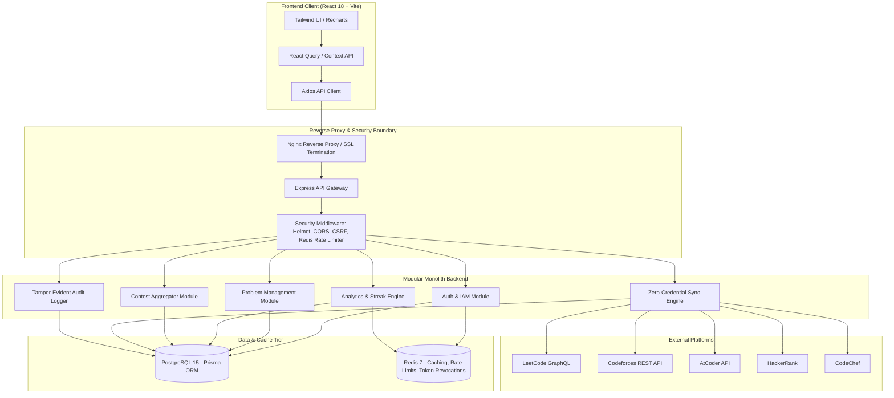

# 🛠️ CodeONE — Developer & Engineering Documentation

> **Comprehensive Developer Guide for System Architecture, Database Design, Security Controls, API Specifications, and Testing.**

---

## 📌 Table of Contents

1. [📐 System Architecture](#-system-architecture)
2. [💻 Tech Stack & Dependencies](#-tech-stack--dependencies)
3. [⚙️ Local Development Setup](#️-local-development-setup)
4. [🗄️ Database Architecture & Prisma ORM](#️-database-architecture--prisma-orm)
5. [⚡ In-Memory Streak Engine & Redis Caching](#-in-memory-streak-engine--redis-caching)
6. [🔐 Authentication & Security Hardening](#-authentication--security-hardening)
7. [🔄 Platform Sync Engine & Adding New Adapters](#-platform-sync-engine--adding-new-adapters)
8. [🔌 Complete REST API Reference](#-complete-rest-api-reference)
9. [🧪 Testing Strategy (Unit, Integration & Security)](#-testing-strategy-unit-integration--security)
10. [🐳 Docker & Production Deployment](#-docker--production-deployment)
11. [🤝 Git Workflow & Contribution Guidelines](#-git-workflow--contribution-guidelines)

---

## 📐 System Architecture

CodeONE is built as a **Security-Hardened Modular Monolith**. All core domain logic lives in a single, well-structured codebase with strictly bounded contexts, ensuring high development velocity without the operational overhead of microservices.



---

## 💻 Tech Stack & Dependencies

### Frontend
- **Framework:** React.js 18 (Hooks, Suspense, Context API)
- **Bundler:** Vite
- **Styling:** Tailwind CSS + PostCSS
- **Data Visualization:** Recharts (Heatmap, Donut, Multi-line, Radar, Stacked Bar)
- **Icons:** Lucide React
- **HTTP Client:** Axios (interceptor pattern for JWT refresh token rotation)
- **Forms:** React Hook Form

### Backend
- **Runtime:** Node.js 18+ LTS
- **Framework:** Express.js
- **Database:** PostgreSQL 15+
- **ORM:** Prisma ORM v5
- **In-Memory Cache & Key-Value:** Redis 7 (via `ioredis`)
- **Authentication:** JWT (Stateless access tokens + stateful rotated refresh tokens)
- **Password Hashing:** `bcryptjs` (10 rounds)
- **Validation:** Joi schema validation
- **Logging:** Winston + Morgan
- **Email:** Nodemailer

---

## ⚙️ Local Development Setup

### 1. Prerequisites
Verify software installations:
```bash
node -v    # >= 18.0.0
npm -v     # >= 9.0.0
docker -v  # Optional, but recommended for DB
```

### 2. Clone and Setup Environment Variables

```bash
git clone https://github.com/ishendrarai/CodeONE.git
cd CodeONE

# Backend setup
cd server
cp .env.example .env

# Frontend setup
cd ../client
cp .env.example .env
```

### 3. Spin up PostgreSQL and Redis
Using Docker Compose for local dependencies:
```bash
# From project root
docker-compose -f docker/docker-compose.yml up -d postgres redis
```
Or start local PostgreSQL and Redis services natively on standard ports (`5432` and `6379`).

### 4. Install Dependencies & Migrate Database

```bash
# Root directory - installs both client and server via npm workspaces
npm install

# Run Prisma schema migrations and generate client
cd server
npx prisma migrate dev --name init

# Seed database with sample competitive programming accounts & problems
npm run seed
```

### 5. Start Development Servers

You can run both concurrently from root:
```bash
# In project root
npm run dev
```
Or run each independently:
- **Backend API:** `cd server && npm run dev` (Runs on `http://localhost:5000`)
- **Frontend App:** `cd client && npm run dev` (Runs on `http://localhost:5173`)

---

## 🗄️ Database Architecture & Prisma ORM

The schema is defined in [`server/prisma/schema.prisma`](file:///c:/Users/ishur/CodeOne/server/prisma/schema.prisma).

### Key Entities:
1. `User`: Primary user credentials, role (`USER`, `MODERATOR`, `ADMIN`, `AUDITOR`), profile settings, and handle.
2. `RefreshToken`: Cryptographic SHA-256 token hashes, expiration, revocation status, and `familyId` for reuse detection.
3. `PlatformAccount`: Stores user handles on LeetCode, Codeforces, AtCoder, HackerRank, CodeChef, and Topcoder with cached ratings and sync error logs.
4. `Problem` & `ProblemTag`: Canonical list of competitive programming problems, difficulties, tags, and acceptance rates.
5. `UserProblem`: Stores user-specific problem metadata, status (`SOLVED`, `IN_PROGRESS`, `REVIEW_LATER`, `TODO`), custom Markdown notes, key insights, algorithm notes, and code snippets.
6. `Contest` & `UserContest`: Aggregated upcoming contests, start times, durations, and user registration/reminder states.
7. `Goal`: Daily, weekly, or monthly targets with target counts, completion flags, and date ranges.
8. `AuditLog`: Append-only, tamper-evident security audit trail with actor details, request IDs, IP addresses, and outcomes.

### Prisma CLI Commands:
```bash
# Format schema
npx prisma format

# Create and apply new migration
npx prisma migrate dev --name <migration_name>

# Open Prisma Studio GUI
npx prisma studio
```

---

## ⚡ In-Memory Streak Engine & Redis Caching

CodeONE delivers sub-millisecond streak analytics and real-time dashboard data using Redis 7.

### Caching Strategy & Expiration Matrix

| Key Pattern | Description | TTL | Invalidation Trigger |
|---|---|---|---|
| `cache:dashboard:{userId}` | Dashboard aggregates & stat cards | 15 min | Problem status update or platform sync |
| `cache:streaks:{userId}:{year}` | 365-day solved activity array | 10 min | New problem solved |
| `cache:contests:upcoming` | Global contest calendar events | 30 min | Scheduled scraper job |
| `token:blacklist:{jwtId}` | Blacklisted revoked access tokens | Expiry | User logout / token revocation |
| `ratelimit:{ip}:{endpoint}` | Sliding window rate limiting counter | 15 min | Automatic TTL expiry |

### Streak Calculation Engine
Streaks are calculated using submission timestamps normalized to the user's local timezone. The engine checks continuous daily solve activity; a user's streak continues if at least one problem was solved in the preceding 24–48 hour window, providing a 1-day grace period for timezone variance.

---

## 🔐 Authentication & Security Hardening

CodeONE adheres to **Zero-Trust** principles and defensively mitigates OWASP Top 10 vulnerabilities:

### 1. Token Lifecycle & Refresh Token Rotation (RTR)
- **Short-Lived Access Tokens:** Signed with HMAC-SHA256, expiration: 15 minutes.
- **Rotated Refresh Tokens:** On every `/api/auth/refresh` invocation, the current refresh token is revoked, and an entirely new token with the same `familyId` is issued.
- **Reuse Detection:** If an already-revoked refresh token is presented, the entire token family is immediately revoked, forcing all active sessions for that user to terminate.

### 2. Role-Based Access Control (RBAC) & IDOR Protection
- 4 defined roles: `USER`, `MODERATOR`, `ADMIN`, `AUDITOR`.
- Every route accessing user-owned resources (e.g., `/api/problems/:id`, notes, settings) verifies that the authenticated user owns the resource or has `ADMIN` privileges.

### 3. Append-Only Tamper-Evident Audit Logging
- Every sensitive operation (login, failed password attempt, token refresh, platform linking, user deletion) triggers an entry in `AuditLog`.
- The application database credentials have insert-only privileges on the audit table to prevent unauthorized history alteration.

### 4. Input Sanitization & Parameterized Queries
- All incoming payloads pass through strict **Joi** schemas before reaching controllers.
- Prisma ORM generates strictly parameterized SQL queries, eliminating SQL Injection.

---

## 🔄 Platform Sync Engine & Adding New Adapters

The sync engine uses the **Adapter Design Pattern**. All platform fetchers reside in [`server/src/modules/sync/adapters/`](file:///c:/Users/ishur/CodeOne/server/src/modules/sync/adapters).

### How to Implement a New Platform Adapter:
Every platform adapter must implement the following interface:

```javascript
// server/src/modules/sync/adapters/sample.adapter.js
class SampleAdapter {
  constructor() {
    this.name = 'sample_platform';
  }

  /**
   * Verify whether a username exists on the external platform
   * @param {string} username 
   * @returns {Promise<boolean>}
   */
  async verifyUsername(username) {
    // Return true if account exists
  }

  /**
   * Fetch user rating, rank, and total solved count
   * @param {string} username 
   * @returns {Promise<{ rating: number, rank: string, solvedCount: number }>}
   */
  async fetchUserProfile(username) {
    // Scrape or call platform API
  }

  /**
   * Fetch recent submissions
   * @param {string} username 
   * @returns {Promise<Array<{ problemId: string, title: string, difficulty: string, solvedAt: Date }>>}
   */
  async fetchRecentSubmissions(username) {
    // Return recent submissions
  }
}

module.exports = new SampleAdapter();
```

---

## 🔌 Complete REST API Reference

Base URL: `http://localhost:5000/api`

### 1. Authentication (`/api/auth`)
- `POST /api/auth/register` — Create new account (Joi validated)
- `POST /api/auth/login` — Authenticate and receive Access & Refresh tokens
- `POST /api/auth/refresh` — Rotate refresh token and obtain new access token
- `POST /api/auth/logout` — Revoke active refresh token family and blacklist access token
- `GET /api/auth/me` — Get authenticated user session

### 2. Analytics & Streaks (`/api/analytics`)
- `GET /api/analytics/dashboard` — High-level KPI counts, weekly momentum, and donut metrics
- `GET /api/analytics/streaks?year=2024` — Full-year contribution heatmap array
- `GET /api/analytics/performance` — Detailed difficulty progression and radar chart metrics
- `GET /api/analytics/platform/:platformName` — Platform-specific rating history and breakdown

### 3. Problems (`/api/problems`)
- `GET /api/problems` — Filterable problem list (`platform`, `difficulty`, `status`, `page`, `limit`, `search`)
- `GET /api/problems/:problemId` — Problem detail with approach notes and complexity
- `PATCH /api/problems/:problemId` — Update problem status, personal notes, code snippets, and tags
- `POST /api/problems/sync` — Trigger immediate sync across all connected platforms

### 4. Contests (`/api/contests`)
- `GET /api/contests/upcoming` — Upcoming contests with countdown times and direct URLs
- `POST /api/contests/:contestId/reminder` — Toggle contest registration reminder

### 5. Goals (`/api/goals`)
- `GET /api/goals/active` — Active targets and progress percentages
- `POST /api/goals` — Create daily, weekly, or monthly goal
- `DELETE /api/goals/:goalId` — Delete a goal

### 6. User Profile & Settings (`/api/user`)
- `PATCH /api/user/profile` — Update display name, bio, and handle
- `POST /api/user/platforms` — Link platform username (e.g., LeetCode, Codeforces)
- `DELETE /api/user/platforms/:platform` — Disconnect platform
- `POST /api/user/pat` — Generate new Personal Access Token

---

## 🧪 Testing Strategy (Unit, Integration & Security)

Tests are built with **Jest** and **Supertest** in [`server/tests/`](file:///c:/Users/ishur/CodeOne/server/tests).

```bash
# Run all test suites
npm test --workspace=server

# Run tests with test coverage breakdown
npm run test:coverage --workspace=server

# Run security regression tests specifically
npx jest tests/security
```

### Coverage Targets:
- **Unit Tests:** Streak calculation logic, timezone boundary math, platform adapters error parsing.
- **Integration Tests:** Authentication flows (registration, duplicate email handling, JWT rotation).
- **Security Tests:** IDOR attacks (User A modifying User B's problem notes), RBAC privilege escalation, refresh token replay detection, and rate limiter enforcement.

---

## 🐳 Docker & Production Deployment

All services can be deployed with Docker Compose:

```bash
# Build and run containers
docker-compose -f docker/docker-compose.yml up --build -d

# View real-time container logs
docker-compose -f docker/docker-compose.yml logs -f

# Gracefully stop containers
docker-compose -f docker/docker-compose.yml down
```

### Container Services:
1. `codeone_postgres`: PostgreSQL 15 database on internal network.
2. `codeone_redis`: Redis 7 instance with persistence enabled.
3. `codeone_backend`: Node.js Express server running on port `5000`.
4. `codeone_frontend`: Production Nginx web server on port `80` reverse-proxying `/api` traffic to backend.

---

## 🤝 Git Workflow & Contribution Guidelines

1. **Branch Naming:**
   - Features: `feat/component-name` (e.g. `feat/contest-calendar`)
   - Bugfixes: `fix/streak-timezone-offset`
   - Security: `sec/refresh-token-rotation`
2. **Commit Message Format:**
   ```
   feat(analytics): add topic mastery radar aggregation endpoint
   fix(auth): invalidate refresh token family on replay detection
   docs(readme): add GLA university supervisor details
   ```
3. **Pull Requests:** Ensure your PR passes all unit tests and builds cleanly without warnings before requesting reviews.

