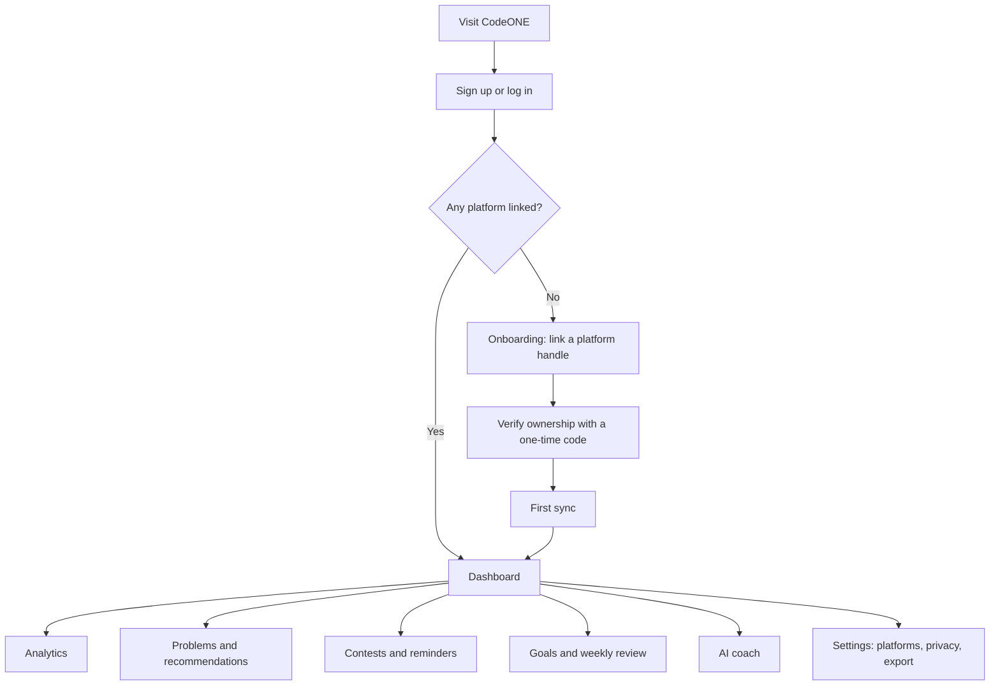
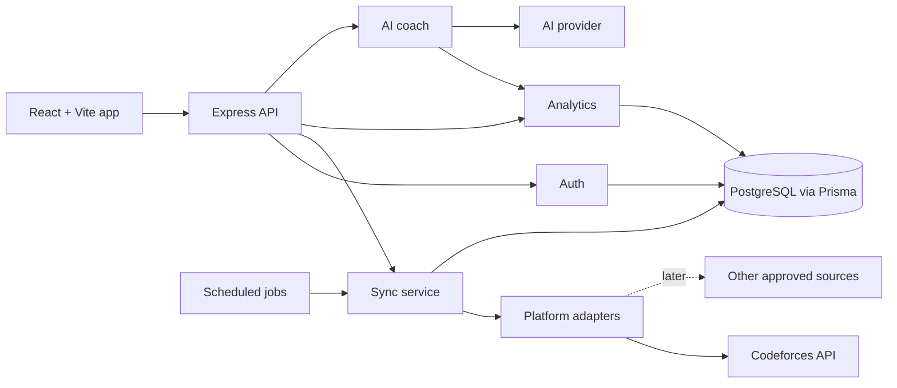

# CodeONE
 
## About
 
Competitive programmers practise on several platforms, but each one only shows its own slice of the picture. There is no single place to see overall consistency, weak topics or the next contest.
 
CodeONE is a unified analytics layer. You create an account, link your coding profiles, and CodeONE turns your public activity into streaks, trends and practical suggestions for what to practise next. An AI coach helps you act on those insights.
 
---
 
## Features
 
**See where you stand**
- **Global streak and heatmap:** one streak across all linked platforms, with a 365-day activity view
- **Rating and contest performance:** rating history, rating change per contest and best and worst contests
- **Difficulty and topic breakdown:** what you solve, how hard, and how often you succeed per topic
**Know what to practise**
- **Weak-topic detection:** topics where your success rate is low, shown with enough data to be trustworthy
- **Upsolve queue:** problems you attempted in a contest but never solved
- **Smart recommendations:** unsolved problems slightly above your level, in your weak topics
**Stay consistent**
- **Goals:** daily and weekly targets with progress tracking
- **Streak-at-risk alerts:** a nudge before your streak breaks
- **Weekly review:** a summary of what you solved, what improved and what to focus on next
**Never miss a contest**
- **Contest hub:** upcoming contests from all your platforms in one calendar with live countdowns
- **Reminders and calendar export:** get notified and add contests to your own calendar
**Keep your own notes**
- **Problem notebook:** mark status, bookmark problems and write notes on approaches and mistakes
**Compare and share**
- **Compare:** put yourself side by side with a friend
- **Profile card:** an opt-in shareable summary of your progress
**AI coach (planned)**
- An agent that understands your stats and helps you improve, described below
**Your data stays yours**
- Export or delete everything at any time
### AI Coach
 
The coach is an agent that reads your own synced data and helps you decide what to do next. It can:
 
- Answer questions such as "Why did my rating drop last month?" or "What should I solve today?"
- Build a 30/60/90-day study plan from your goal, daily time and weak topics, and adjust it as you progress
- Explain a weak topic and suggest a short practice path with problems in increasing difficulty
- Prepare you for an upcoming contest with a focused warm-up set
- Write your weekly review and turn it into concrete next steps
How it stays safe and useful:
- It only uses your own data, fetched through server-side tools, and never other users' data
- Only the minimum needed information is sent to the AI provider
- Suggestions are guidance, not guarantees of a rating or result
- It says so when your data is incomplete instead of guessing
---
 
## How It Works
 
### User workflow
 

 
1. **Sign up or log in** with your own credentials.
2. **Onboarding:** on first login you are guided to link a platform. Codeforces comes first.
3. **Verify ownership:** you prove the handle is yours by placing a one-time code on your public profile. No platform passwords are ever requested.
4. **First sync:** CodeONE fetches your public history and stores it against your account.
5. **Land on the dashboard,** where you can:
   - review streak, rating and topic strengths in **Analytics**
   - work through your upsolve queue and recommended problems in **Problems**
   - check upcoming contests and set reminders in **Contests**
   - set targets and read your weekly review in **Goals**
   - ask the **AI coach** for a plan or an explanation
   - manage linked platforms, privacy and data export in **Settings**
6. **Stay up to date:** data refreshes on a schedule and on demand, and every platform shows its last-synced time.
### How multiple platforms are handled
 
Each user can link several platform accounts, and everything is stored in the database against that user.
 
- **Linked accounts:** for each platform CodeONE keeps your handle, verification status and sync status.
- **Adapters:** every platform has its own adapter that fetches data within that platform's rate limits and converts it into one common format. Analytics only ever sees the common format, so adding a platform never changes the analytics code.
- **Stored data:** normalised submissions, rating history and contest results are saved per account, so dashboards load fast and work from history rather than live API calls.
- **Honest status:** each platform shows connected, partial data, rate limited or not connected, together with its last sync time.
- **Combined, not blended:** streaks and solved counts combine across platforms, but ratings are never averaged, because each platform has its own scale.
| Platform | Access | Status |
|---|---|---|
| Codeforces | Official public API | First supported platform |
| AtCoder | Third-party service (AtCoder Problems) | Planned |
| Codewars | Official API | Planned |
| LeetCode, CodeChef | No approved public API | Not connected; manual import planned |
 
CodeONE never scrapes websites or asks for passwords or session cookies from other platforms.
 
---
 
## Tech Stack
 
| Layer | Choice | Why |
|---|---|---|
| Frontend | React 18, Vite, TypeScript | Fast builds and type safety |
| UI | Tailwind CSS, shadcn/ui, lucide-react | Accessible components with consistent styling |
| Data fetching | TanStack Query | Caching, retries and loading states |
| Forms and validation | React Hook Form, Zod | Shared validation rules |
| Charts | Recharts | Themeable charts and heatmaps |
| Backend | Node.js 22, Express, TypeScript | Simple and well supported |
| Database | PostgreSQL | Relational data and strong analytics queries |
| ORM | Prisma | Type-safe queries and versioned migrations |
| Authentication | Argon2id, short-lived JWT access token, rotating refresh token in an HttpOnly cookie | Secure and revocable sessions |
| Hardening | Helmet, CORS allowlist, express-rate-limit | Baseline API protection |
| Scheduled jobs | node-cron | Periodic sync without extra infrastructure |
| AI coach | Claude API with tool use, called from the server | The agent reads your stats through safe, user-scoped tools |
| Logging | Pino | Structured, fast logs |
| Testing | Vitest, Supertest, React Testing Library, Playwright | Unit, API and end-to-end coverage |
| Tooling | ESLint, Prettier, Husky, GitHub Actions | Consistent code and automated checks |
| Local dev | Docker Compose | One-command local database |
| Hosting | Render (web service, static site, managed PostgreSQL) | Simple deploy with a hosted database |
 
---
 
## Architecture
 

 
- **Modular monolith:** auth, sync, analytics, contests and the coach are separate modules in one deployable service.
- **Single source of truth:** streaks and activity are derived from stored submissions with accurate timestamps.
---
 
## Getting Started
 
**Prerequisites:** Node.js 22+, npm 10+, Docker (or a local PostgreSQL 15+), Git.
 
```bash
# 1. Clone
git clone https://github.com/ishendrarai/CodeONE.git
cd CodeONE
 
# 2. Start the local database
docker compose up -d
 
# 3. Backend
cd server
npm install
cp .env.example .env          # then fill in the values
npx prisma migrate dev
npm run dev                   # http://localhost:5000
 
# 4. Frontend (new terminal)
cd client
npm install
cp .env.example .env
npm run dev                   # http://localhost:5173
```
 
Open `http://localhost:5173`, create an account and link your handle.
 
---
 
## Environment Variables
 
Copy `.env.example` to `.env` in both `server/` and `client/` and set your own values. Never commit `.env` files.
 
**server**
 
| Variable | Purpose |
|---|---|
| `PORT` | API port |
| `NODE_ENV` | `development` or `production` |
| `CLIENT_URL` | Frontend origin (CORS and cookies) |
| `DATABASE_URL` | PostgreSQL connection string |
| `JWT_ACCESS_SECRET` | Secret for access tokens |
| `JWT_REFRESH_SECRET` | Secret for refresh tokens |
| `COOKIE_SECRET` | Secret for signed cookies |
| `AI_API_KEY` | Key for the AI coach (optional; the coach is disabled without it) |
 
**client**
 
| Variable | Purpose |
|---|---|
| `VITE_API_URL` | Base URL of the API |
 
Generate strong secrets with:
 
```bash
node -e "console.log(require('crypto').randomBytes(64).toString('hex'))"
```
 
---
 
## Scripts
 
| Command | Where | What it does |
|---|---|---|
| `npm run dev` | server, client | Start in development mode |
| `npm run build` | server, client | Production build |
| `npm start` | server | Run the built API |
| `npm test` | server, client | Run unit and API tests |
| `npm run lint` | server, client | Lint the code |
| `npx prisma migrate dev` | server | Create and apply migrations locally |
| `npx prisma migrate deploy` | server | Apply migrations in production |
| `npx prisma studio` | server | Browse the database locally |
 
---
 
## Project Structure
 
```text
CodeONE/
├── client/              # React app
│   └── src/
│       ├── components/  # shared UI and feature components
│       ├── pages/
│       ├── hooks/
│       ├── services/    # API client
│       └── styles/      # design tokens and theme
├── server/              # Express API
│   ├── prisma/          # schema and migrations
│   └── src/
│       ├── modules/     # auth, sync, analytics, contests, coach
│       ├── integrations/# platform adapters
│       ├── middleware/
│       └── jobs/        # scheduled tasks
├── docker-compose.yml   # local database
└── README.md
```
 
---
 
## Security and Privacy
 
- Passwords are hashed with Argon2id and are never stored or logged in plain text.
- Short-lived access tokens, with refresh tokens rotated and revocable.
- Every user-owned resource is checked server-side, so one user can never read another user's data.
- All input is validated, and database access goes through Prisma's parameterised queries.
- Rate limiting on login, sign-up, sync and AI coach endpoints.
- CodeONE only reads public platform data and never asks for passwords or session cookies from other sites.
- Secrets live in environment variables and are never committed.
- You can export or delete your data.
To report a vulnerability, contact the maintainer privately instead of opening a public issue.
 
---
 

 